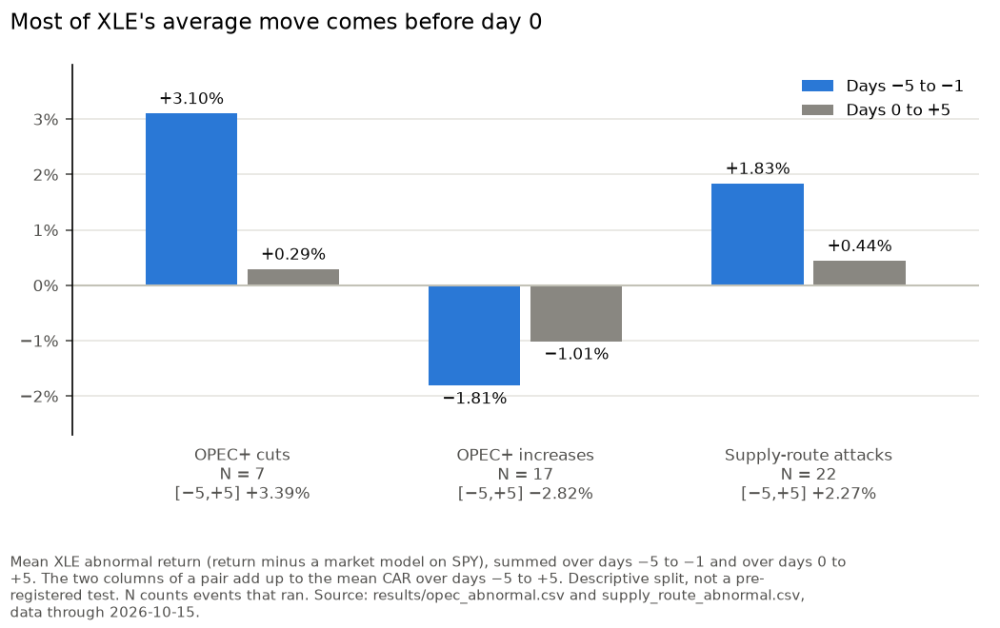
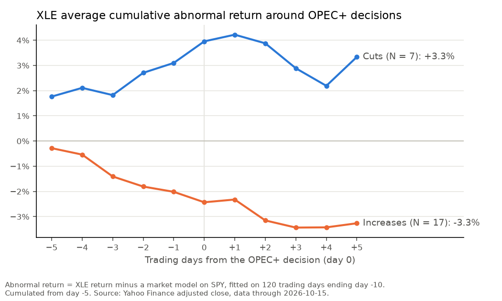
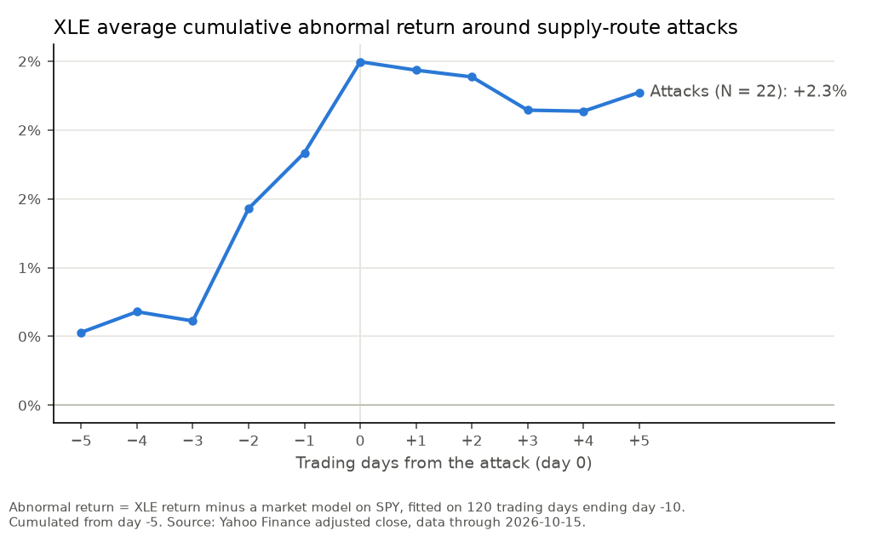
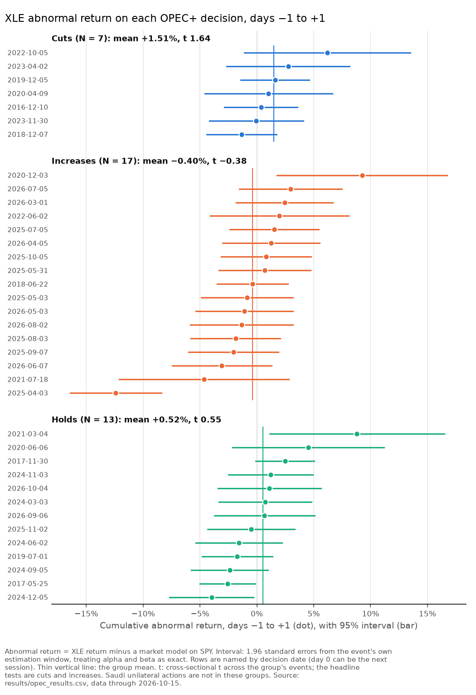
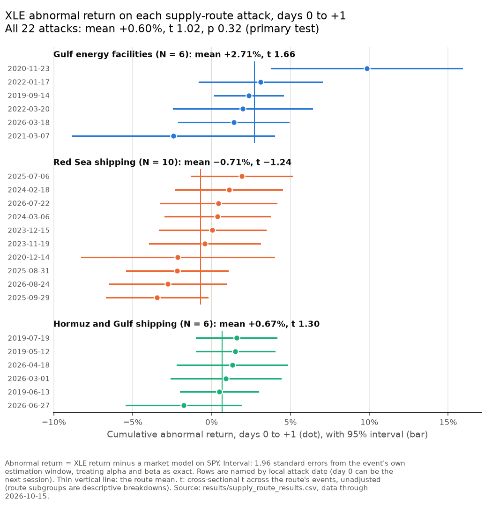
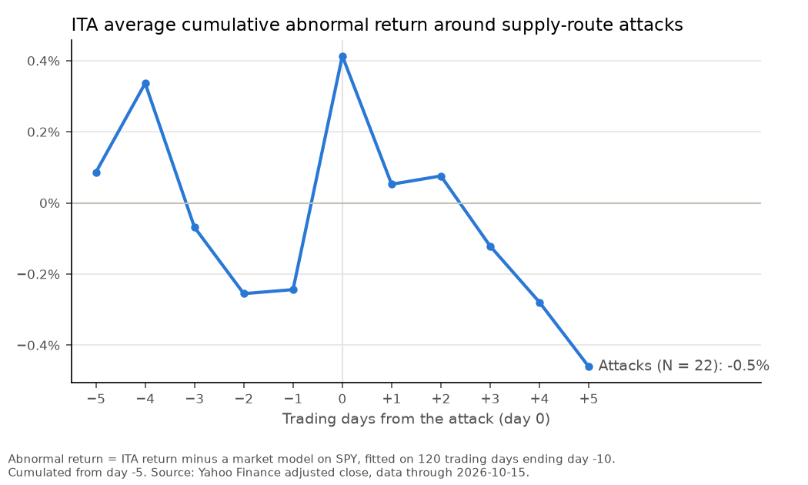
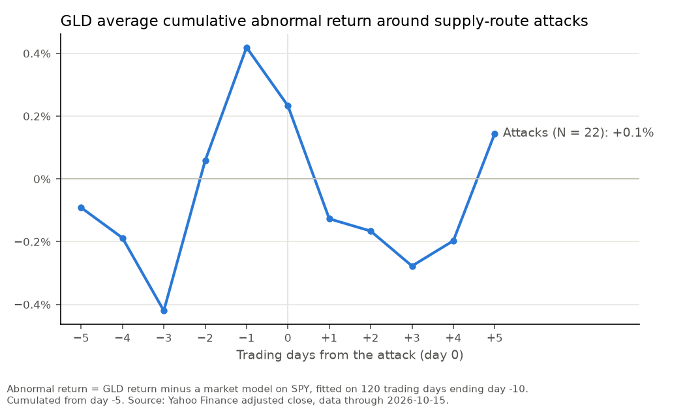

# Geopolitical Events and Markets: An Event Study

[](https://github.com/JohnMitiguy/event-study/actions/workflows/ci.yml)

[](LICENSE)

## Summary

**The question.** When OPEC+ changes oil production, or someone attacks the routes Gulf oil moves through, do energy, defense and gold stocks move more than the overall market would predict? For a trader or an analyst the timing matters as much as the size: if the move comes before the news is official, reacting to the headline is too late.

**What I built.** Two event studies in Python on one tested framework:

- **37 OPEC+ production decisions** (Dec 2016 to Oct 2026), measured on the energy sector ETF (XLE). See [OPEC+ decisions](#opec-decisions).
- **22 attacks on Gulf energy facilities, Red Sea shipping and the Strait of Hormuz** (May 2019 to Aug 2026), measured on energy (XLE), defense (ITA) and gold (GLD) ETFs. See [Supply-route attacks](#supply-route-attacks).

Each security is compared with what the S&P 500 (SPY) predicts for it, from a market model fitted on the months before each event. The main test of each study was fixed and logged before its first run. Later event types are planned: terrorist attacks, tariffs and OFAC sanctions.

Two terms used throughout. **CAR** (cumulative abnormal return) is a security's return minus what SPY predicts, summed over a window of trading days around the event; day 0 is the first day the market could react. **t** is the t-statistic of the average CAR across events: roughly 2 or more (in absolute value) is needed for significance at 5%, a bit more with few events. **p** is the chance of an average at least this far from zero if the events had no effect.



### Key findings

1. **Most of XLE's move around OPEC+ decisions comes before the official news.** By the day before a cut is announced, XLE is already +3.10% ahead of what SPY predicts (summed from day -5). Days 0 and +1 add +1.13%, then most of that fades, so days 0 to +5 add only +0.29% net. Increases show the same pattern in reverse: -1.81% before day 0 and -1.01% from day 0 to +5. *Strength:* a descriptive split, not a pre-registered test, and the cut run-up rests on few events. Two of the 7 cuts (Apr 2020 +9.14%, Oct 2022 +9.74%) carry most of it, and the median cut is +1.18%.
2. **Production increases come with a slow drift down in XLE, a borderline result.** Over days -5 to +5 the 17 increases average -2.82% (t -2.08, p 0.054), just short of 5% significance. Without the 3 increases whose announcement time is assumed, the other 14 average -4.10% (t -2.90). *Strength:* suggestive only. This was not the pre-set headline window, and the pre-set test (days -1 to +1) is null: cuts +1.51% (t 1.64, N 7), increases -0.40% (t -0.38, N 17). One increase (3 Apr 2025) lands on the US tariff selloff.
3. **Attacks on supply routes barely move energy beyond the market.** On the attack day and the next (days 0 to +1), XLE averages +0.60% (t 1.02, p 0.32, N 22). The sign is the expected one, but the average can't be told apart from zero. One event carries much of it: without the Nov 2020 strike on Aramco's Jeddah plant, which landed on the same days as a vaccine and Biden-transition rally, the other 21 attacks average +0.16%. Direct hits on Gulf energy facilities show the largest average (+2.71%, N 6, t 1.66), which fits a hit on supply, but with 6 events it is not significant. *Strength:* the pre-registered primary test is a clear null.
4. **XLE's wider-window rise around attacks comes before the attacks.** Over days -5 to +5 XLE is +2.27% (p 0.035), but adjusted for the five secondary tests (Holm) its p is 0.18, and +1.83% of it comes before day 0. Attacks are not scheduled, so that run-up can't be a reaction to them.
5. **Defense (ITA) and gold (GLD) show nothing.** All four of their tests have a Holm-adjusted p of 1.00.

**What this suggests (interpretation, not a tested result).** Scheduled supply news like OPEC+ decisions is largely priced in before the official release, through expectations and leaks, so by release day most of the average move has already happened. On average, one-off attacks move energy stocks little beyond the market. The one hint of a real reaction is direct hits on Gulf energy facilities, and there are too few of them to confirm it.

<p>


</p>

### Why the results hold up

- **Tests fixed in advance.** Each study's primary test was logged in [DECISIONS.md](DECISIONS.md) before its first run (for the attacks, before any returns were read), so a headline can't be the best of many tries.
- **Multiple-testing correction.** The attack study's five secondary tests are Holm-adjusted.
- **No look-ahead.** Each market model is fitted only on days ending 10 trading days before its event.
- **Overlapping news is masked.** Estimation windows skip the days around every other event, including real news that is not tested (failed OPEC+ meetings, attacks too close to a counted one), and each study skips the other study's events.
- **Reproducible.** Prices are a frozen snapshot, and every run records the hashes of the prices and events files and the git commit.
- **Tested.** 468 automated tests run in CI, including a simulation checking that the test statistic doesn't flag effects on pure noise more often than it should.
- **Robustness checks:** shifted dates, official instead of leak times, outlier exclusion, and a pre-war sample.
- **Nulls are reported as nulls,** and every known confound is disclosed in the results, [Caveats](#caveats) and [Limitations](#limitations).

Every methodology decision and its reason is logged in [DECISIONS.md](DECISIONS.md).

## Method

This part is shared by both event types. Each event type then fixes its own groups, windows and main test, in its own section below.

For each event and security, a market model is fitted by ordinary least squares: the security's daily return regressed on SPY's, over an estimation window that ends before the event (by default 120 trading days, ending 10 trading days before day 0). Days inside another event's widest event window (days -5 to +5 of that event, with the default windows) are left out, and the window reaches further back instead. The same goes for real news that is not tested, such as failed OPEC+ meetings or attacks too close to a counted one, listed in the mask-only files (`events/opec_mask_only.csv`, `events/supply_route_mask_only.csv`). Each study also skips the other study's windows: OPEC+ estimation windows skip attack windows, and attack estimation windows skip OPEC+ windows. So the regression still uses 120 days, none of them inside another event's window. The results show each event's first and last estimation day (`est_start`, `est_end`) and how many days were skipped (`est_masked_days`).

The abnormal return on each day around the event is the security's actual return minus what the model predicted from SPY that day. Abnormal returns are summed into cumulative abnormal returns (CARs) over short windows. Day 0 is the first trading day the market could react to the news: a time at or after that day's close (4pm ET, or 1pm on early-close days), on a weekend or on a holiday rolls forward to the next trading day. The event time is the leak time if there was a credible timed leak, otherwise the official announcement or report time. All windows count trading days, not calendar days. Returns are simple daily returns from adjusted close prices.

CARs are then averaged across events and the average is tested: cross-sectional t-test (primary), standardized-CAR (BMP) test and Wilcoxon signed-rank test (robustness), and a sign test (reported only). N counts only events that ran; any event that fails is listed with its reason. A group with fewer than 5 events is not tested. Methodology choices and the reasons for them are in [DECISIONS.md](DECISIONS.md).

## OPEC+ decisions

### Design

37 OPEC+ production decisions from Dec 2016 to Oct 2026, on XLE. Windows are days -1 to +1 and -5 to +5. Cuts, increases and holds are tested separately, because cuts should push XLE up and increases push it down, so pooling them cancels out. The headline was fixed before the first full run: the cross-sectional t on [-1,+1], for cuts and for increases. Saudi unilateral actions are a separate group and never enter the main averages.

### Results

v1.1 run, 27 Oct 2026: 37 OPEC+ decisions from Dec 2016 to Oct 2026, all 37 ran (none failed), prices through 15 Oct 2026. From v1.1 the estimation windows also skip every supply-route attack, so the numbers differ slightly from v1.0.0 (see [What changed in v1.1](#what-changed-in-v11)). Event time is the leak time where there is one (one event), otherwise the announcement. The average-CAR chart is in the [Summary](#summary).

| Group | N | Mean CAR [-1,+1] | t | Mean CAR [-5,+5] | t |
|---|---|---|---|---|---|
| Cuts | 7 | +1.51% | 1.64 | +3.39% | 1.49 |
| Increases | 17 | -0.40% | -0.38 | -2.82% | -2.08 |
| Holds | 13 | +0.52% | 0.55 | +0.60% | 0.50 |

t is the cross-sectional t-test. The headline is the [-1,+1] column for cuts and increases.



**What it says.**

- **The headline is a null result.** XLE moves the way theory says (up after cuts, down after increases), but neither [-1,+1] average is statistically different from zero. With only 7 cuts, a test at 5% would need a much larger average reaction to register. The chart shows why: most single-event intervals cross zero, and a few events far from the rest (3 Apr 2025, 3 Dec 2020, 4 Mar 2021) move the averages.
- **Increases over [-5,+5] are borderline.** -2.82% (t -2.08, p 0.054; BMP t -2.19; Wilcoxon p 0.080). Dropping any single event gives t between -1.72 and -2.51, so the result depends on which events are in. This window was not the headline, so treat it as suggestive at most, not as the finding.
- **Much of the move comes before day 0.** By day -1, cuts are up +3.10% on average (median +1.18%; opec_2020_04_09 +9.14% and opec_2022_10_05 +9.74% carry most of it) and increases down -1.81%. From day 0 to +5, cuts add +0.29% and increases -1.01%; without opec_2025_04_03, the other 16 increases add -0.05%. That fits decisions being reported or expected days before the official release. The 10-day gap before the estimation window keeps this run-up out of the baseline. These before and after splits are descriptive checks, not pre-registered tests.

**Robustness.**

- **Day 0 one trading day later for the 13 rows with an assumed announcement time:** cuts [-1,+1] +0.80% (t 0.59), increases -0.70% (t -0.77), increases [-5,+5] -2.82% (t -2.06).
- **Without those 13 rows:** only 3 cuts remain, too few to test. Increases (N 14) are -1.26% on [-1,+1] (t -1.22) and -4.10% on [-5,+5] (t -2.90).
- **Without events fitted on the 5 most extreme days:** the 5 largest XLE-minus-beta-times-SPY days of 2010 to 2026 are 9 Nov 2020 (+13.0%), 9 Mar 2020 (-12.1%), 18 Mar 2020 (-9.1%), 17 Apr 2020 (+7.8%) and 2 Apr 2020 (+6.8%). Five events are fitted on one of them and are dropped (Apr, Jun and Dec 2020, Mar and Jul 2021). Cuts (N 6) are +1.59% on [-1,+1] (t 1.46) and increases (N 15) are -0.76% (t -0.80), with increases at -2.93% on [-5,+5] (t -2.16).
- **Official announcement time instead of the leak:** the numbers are identical, because the one leak (5 Oct 2022) came the same morning as the release.

**Largest single event.** On 3 Apr 2025 (opec_2025_04_03, an increase), the [-1,+1] CAR is -12.40% (t -6.09). Those days were a broad selloff: SPY fell 4.9% and 5.8% on 3 and 4 Apr, and XLE fell 7.9% and 9.2%. The US tariff announcement came on 2 Apr after the US close (Fox Business), so it lands on the same day 0 as the OPEC+ increase, and the two can't be separated. This is recorded in `confound_note`. Per DECISIONS.md, the event stays in the main run. Without it, the other 16 increases average +0.35% on [-1,+1] (t 0.44).

**Attacks inside OPEC+ windows.** 12 OPEC+ events have a supply-route attack (counted or masked) whose day 0 falls in their [-5,+5], 8 of them increases, and 5 of those have one in [-1,+1] (Jul 2025, Mar, May, Jul and Aug 2026). Attack days are skipped in estimation, never inside event windows, and an attack should lift XLE, so these work against the expected sign for increases. Without those 8, the other 9 increases average -4.85% on [-5,+5] (t -2.35). This is a descriptive check, not a pre-registered test.

Outputs: `results/opec_results.csv` (per event), `results/opec_across_event.csv` (group tests for all three samples: all events, without assumed times, without outlier-fitted events), `results/opec_abnormal.csv` (daily abnormal returns), `charts/opec_events.png` (one panel per event). The robustness runs write the same files with `_day0_shifted` or `_official_time` added. `results/opec_run_info.json` records the data hashes, settings and git commit of each run. `scripts/readme_charts.py` draws `charts/opec_event_cars.png` (each event's [-1,+1] CAR) and `charts/where_the_move_happens.png` (before and from day 0, shared with the attack study) from the main run's CSVs.

### What changed in v1.1

- **OPEC+ estimation windows now also skip the [-5,+5] days of every supply-route attack** (counted and masked), as DECISIONS.md planned. Event days and the event list are unchanged.
- **22 of 37 events got a different estimation window.** The biggest changes are the 2026 events during the war, and the longest look-back went from 197 to 296 trading days.
- **The headline stays null.** Increases over [-5,+5] went from -3.26% (t -2.38, p 0.030) to -2.82% (t -2.08, p 0.054).
- The v1.0.0 results are at the v1.0.0 release tag.

## Supply-route attacks

The question: when Gulf oil supply routes are attacked, do energy, defense or gold move more than the market predicts? A supply shock should lift oil producers (XLE), raise the odds of military spending (ITA) and send money to a safe haven (GLD).

### What counts as an attack

- **An attack event is the first attack on, or a named escalation against,** Gulf energy facilities, Red Sea shipping or the Strait of Hormuz. Routine follow-on incidents in an ongoing campaign are not events.
- **Routes.** `gulf_facility`: an energy facility of a Gulf state, wherever it is (Saudi Red Sea coast sites included). `red_sea`: Red Sea, Bab el-Mandeb and Gulf of Aden shipping. `hormuz`: Persian Gulf, Strait of Hormuz and Gulf of Oman shipping. An attack outside all three is masked, not counted.
- **Escalation.** `first_attack`: the opening attack of its kind (for example the Galaxy Leader seizure, the first Houthi attack on shipping, Nov 2023). `named_escalation`: a later attack that steps up the campaign, through deaths, a sinking or seizure, a new country or facility hit, a return after a lull of 30 days or more, or a source calling it an escalation. The label is a judgment call, and the basis for each one is in `events/supply_route_candidates.md`.
- **Every counted attack has a timestamped primary source.** An official statement copied by a mirror site or quoted in reputable press counts as primary. A UKMTO or JMIC maritime security report time counts as the event time, because that is when the news reached the market. When a source gives several times, the earliest is used. A time with no zone is read as local time at the attack site. An attack with no stated time is masked, even when its date alone would pin day 0. (OPEC+ rows can use an assumed time; attacks can't.)
- **Counted attacks are at least 11 trading days apart**, day 0 to day 0, so no two [-5,+5] windows share a day. A later attack inside that gap is masked: its days are skipped in estimation, but it is never tested.

39 candidate attacks were compiled from primary sources. 22 are counted (`events/supply_route_events.csv`) and 17 are masked (`events/supply_route_mask_only.csv`, listed under [Masked attacks](#masked-attacks)). Each row's notes give the source time as stated, the conversion to Eastern time, and whether the source was checked by fetch or by hand.

### Design

Fixed and logged before any returns were read (DECISIONS.md):

- **Securities:** XLE (primary), ITA and GLD (secondary), each against an SPY market model. The expected sign is positive for all three.
- **Windows:** days 0 to +1 and -5 to +5. The short window starts at day 0, not day -1, because attacks are not scheduled, so the day before carries no news.
- **Primary test:** the cross-sectional t on XLE over [0,+1], with all attacks pooled, two-sided and read unadjusted. Naming one test first avoids picking the best of six.
- **Secondary tests:** the other five security and window pairs, with Holm-adjusted p-values. Every test is two-sided.
- **Subgroups:** route (gulf_facility, red_sea, hormuz) and escalation (first_attack, named_escalation), each tested only with at least 5 events and not adjusted.
- **Pre-war sample:** a robustness check that leaves out attacks on or after 28 Feb 2026, the start of the US-Iran war, because the war moves oil on its own. It has no primary test and no Holm adjustment.
- **OPEC+ news is masked.** Attack estimation windows also skip the windows of every OPEC+ event and OPEC+ mask-only row (both the main and the shifted day 0 of rows with an assumed time), so OPEC+ news doesn't bend XLE's baseline. From v1.1 the OPEC+ runs skip attack windows the same way.

### Results

First run, 27 Oct 2026, on a clean commit: all 22 attacks ran on all three securities (none failed), prices through 15 Oct 2026. The XLE average-CAR chart is in the [Summary](#summary); ITA and GLD are below.

**Primary result: no significant effect.** XLE over [0,+1]: N 22, mean CAR +0.60%, t 1.02, p 0.32. The sign is the expected one and 15 of 22 attacks are positive, but the average can't be told apart from zero.

| Security | Window | N | Mean CAR | t | p | Holm p |
|---|---|---|---|---|---|---|
| XLE | [0,+1] (primary) | 22 | +0.60% | 1.02 | 0.32 | |
| XLE | [-5,+5] | 22 | +2.27% | 2.25 | 0.035 | 0.18 |
| ITA | [0,+1] | 22 | +0.30% | 0.86 | 0.40 | 1.00 |
| ITA | [-5,+5] | 22 | -0.46% | -0.50 | 0.62 | 1.00 |
| GLD | [0,+1] | 22 | -0.55% | -1.06 | 0.30 | 1.00 |
| GLD | [-5,+5] | 22 | +0.14% | 0.14 | 0.89 | 1.00 |

t is the cross-sectional t-test and p is its unadjusted two-sided p-value. Holm p adjusts the five secondary rows together.



**What it says.**

- **The primary test is a null.** XLE moves the expected way, but not by enough to be distinguishable from zero. One event carries much of the mean (see [Largest single event](#largest-single-event)). Without it, the other 21 average +0.16%.
- **No secondary test survives Holm.** XLE over [-5,+5] comes closest (+2.27%, p 0.035, BMP t 2.39, Wilcoxon p 0.030), but adjusted for five tests its p is 0.18. Dropping any one event keeps t between 1.93 and 2.88.
- **The [-5,+5] move is mostly before the attacks.** Days -5 to -1 average +1.83%, and days 0 to +5 add only +0.44%. Unlike OPEC+ meetings, attacks are not scheduled, so a run-up before day 0 can't be a reaction to them. The biggest pre-attack moves belong to attack_2021_03_07 (+9.00%, an OPEC+ decision two sessions earlier) and attack_2020_11_23 (+8.40%).
- **ITA and GLD show nothing**, on either window.

<p>


</p>

The leave-one-out, without-one-event and before-day-0 numbers are descriptive checks run after the results, not pre-registered tests.

**Pre-war sample (robustness only).** This sample keeps the 16 attacks before 28 Feb 2026. XLE [0,+1] +0.86% (t 1.11), XLE [-5,+5] +2.52% (t 1.94), ITA [0,+1] +0.46% (t 1.77), GLD [0,+1] +0.35% (t 0.86). No all-attacks test is significant here either. As in the full sample, the subgroup with the largest t is GLD red_sea [-5,+5] (+3.05%, t 2.82, N 8). It leaves out the 6 attacks of 1 Mar, 18 Mar, 18 Apr, 27 Jun, 22 Jul and 24 Aug 2026.

**Subgroups.** On XLE [0,+1]:

| Group | N | Mean CAR [0,+1] | t |
|---|---|---|---|
| gulf_facility | 6 | +2.71% | 1.66 |
| red_sea | 10 | -0.71% | -1.24 |
| hormuz | 6 | +0.67% | 1.30 |
| first_attack | 5 | +1.11% | 1.87 |
| named_escalation | 17 | +0.45% | 0.60 |

Attacks on Gulf energy facilities show the largest average, which fits a direct hit on supply, but with 6 events it is not significant. The per-attack chart above shows the same breakdown event by event. Across all 30 subgroup tests (5 groups, 2 windows, 3 securities), three have a t above 2 in absolute value: GLD red_sea [-5,+5] +2.73% (t 3.10), GLD hormuz [0,+1] -1.72% (t -2.17) and XLE gulf_facility [-5,+5] +6.13% (t 2.05). Out of 30 tests, a few like this are expected by chance. In the pre-war sample, hormuz and first_attack have 3 events each and are not tested.

**Excluded events.** None of the 22 failed or was dropped from any test. The 17 masked attacks are listed under [Masked attacks](#masked-attacks).

### Largest single event

On 23 Nov 2020 a Houthi missile hit a fuel tank at Aramco's North Jeddah bulk plant (attack_2020_11_23), at 03:50 local time, before the US open. XLE's [0,+1] CAR is +9.84% (t 3.19), the largest of the 22. The same two days carried a global risk-on rally: Oxford/AstraZeneca released positive Phase 3 vaccine results at 07:00 GMT on 23 Nov (AstraZeneca), stocks rose late on 23 Nov on a report that Janet Yellen would be the Treasury pick (Fox Business), the GSA cleared the Biden transition the same day (CBS News), and oil rallied nearly 10% over the four sessions to 25 Nov, with traders citing the vaccines and the transition (Reuters). The attack and the rally can't be separated. This is recorded in `confound_note`, and the event stays in the main run. Without it, the other 21 attacks average +0.16% on XLE [0,+1].

### Caveats

- **GLD has a beta near zero against SPY** (median -0.03 before 2026), so its abnormal return is close to its raw return. SPY is kept as its benchmark so all three use the same model (DECISIONS.md).
- **ITA overlaps SPY.** Defense stocks are in the S&P 500 and ITA's beta is 0.63 to 1.14, so a move that lifts large caps in general is partly taken out as "expected".
- **XLE's beta is low in 2026.** It is 1.06 to 1.35 for the 2019 to 2021 attacks, and 0.02 to 0.29 for the 2026 attacks. The OPEC+ run shows the same drop over the same months.
- **2026 estimation windows reach back to mid-2025.** OPEC+ decisions are monthly and many attacks during the war are masked, so the 2026 windows skip 83 to 165 days and start between Apr and Jun 2025. Their baselines come mostly from before the war.
- **attack_2026_07_22 is a UKMTO report at exactly 16:00 ET**, the close, so its day 0 rolls to Thu 23 Jul.
- **Seven attack windows contain an OPEC+ decision.** OPEC+ days are masked in estimation, not inside event windows. Two attacks share day 0 with an OPEC+ increase: attack_2025_07_06 (opec_2025_07_05) and attack_2026_03_01 (opec_2026_03_01). An increase should push XLE down, so these work against the expected sign; without them XLE [0,+1] is +0.52% (t 0.80, N 20). Five more have one elsewhere in [-5,+5]: attack_2021_03_07 and attack_2024_03_06 (holds at day -2), attack_2025_08_31 and attack_2026_06_27 (increases at day +4), attack_2025_09_29 (an increase at day +5).
- **attack_2021_03_07 is 2 sessions after opec_2021_03_04** (an OPEC+ hold, XLE [-1,+1] +8.80%). Its [-5,+5] CAR (+5.96%) carries that move, while its [0,+1] (-2.42%) does not. Without it, XLE [-5,+5] is +2.10% (t 2.01). These checks are descriptive, not pre-registered.
- **Four counted attacks share their [0,+1] window with a masked attack.** The spacing rule masks later attacks in estimation but never inside an event window, so the [0,+1] CARs of attack_2019_05_12, attack_2025_07_06, attack_2026_03_01 and attack_2026_03_18 also carry a second attack (mask_2019_05_14, mask_2025_07_07, the two 2 Mar 2026 masks, mask_2026_03_19). Without those four, XLE [0,+1] is +0.41% (t 0.58, N 18), a descriptive check, not a pre-registered test.
- **The 2026 attacks are inside the war**, and the last two came after the Houthis declared a blockade of Saudi Arabia on 20 Jul 2026. The tests assume events are independent, and attacks within one war may not be.
- **Attacks are not the only supply news.** Only attacks and OPEC+ news are masked in estimation. Sanctions, outages and other supply news are not.

Outputs: `results/supply_route_results.csv` (per event and security), `results/supply_route_across_event.csv` (group tests, `all` and `pre_war` samples), `results/supply_route_abnormal.csv` (daily abnormal returns), `results/supply_route_run_info.json` (data hashes, settings and git commit), and per security `charts/supply_route_events_{XLE,ITA,GLD}.png` (one panel per attack) and `charts/supply_route_caar_{XLE,ITA,GLD}.png` (average CAR), plus `charts/supply_route_event_cars.png` (each attack's XLE [0,+1] CAR, drawn by `scripts/readme_charts.py`).

## Limitations

These apply to both event types unless marked.

- **Confounding news.** A CAR picks up everything that moved the security relative to SPY in the window, not only the event. Other news on the same days (an oil supply shock, a big energy company's earnings, a vaccine result, a market-wide selloff that hits energy harder) can look like an event effect. The `confound_note` column records known cases, but it can't catch everything, and longer windows are more exposed.
- **Thin samples.** OPEC+ decisions and major attacks are infrequent, and some subgroups (for example Saudi unilateral actions, or attacks on one route) have only a handful of events. With few events the cross-event test has little power, and one unusual event can drive the average, as the largest single events above show.
- **Few OPEC+ events without the assumed times.** 13 of the 37 OPEC+ events have no sourced announcement time (`time_assumed`). In the without-`time_assumed` report only 3 of the 7 cuts remain (below the 5-event minimum), so the cut group shows "too few events" there and is not tested. The all-events cut group and the shifted run do not have this problem, but they rest on assumed announcement times.
- **Long look-back for 2025 and 2026 events.** OPEC+ decided monthly from 2025, and attacks clustered during the 2026 war, so recent events sit close together. Their estimation windows skip many days (up to 176 for OPEC+ events, 83 to 165 for attacks) and stretch back up to 296 trading days for OPEC+ events and 267 for attacks, so their baselines come from an older period. No cap on the look-back was set (DECISIONS.md). Because everything in between is skipped, two pairs of events are fitted on exactly the same 120 days (2025-05-13 to 2026-02-20): opec_2026_04_05 and opec_2026_05_03, and attack_2026_03_18 and attack_2026_04_18. Each pair shares one baseline, so its two CARs are not independent.
- **2020 baselines (OPEC+).** The April and June 2020 events are fitted on windows that include the March 2020 crash (beta 1.29 and 1.34, residual std 1.7% and 2.0% a day, against a median of 1.2% for all events). Their per-event t statistics are small because of that noise.
- **Overlapping events.** An event's estimation window skips other events' window days and reaches further back, so it can span more than 120 trading days and its beta comes from a slightly older period (`est_start` shows how far back). Only the other events' window days are skipped, not their run-up days before the window. Only events in the events CSVs and the mask-only lists count. Other news is not skipped. Events whose event windows overlap each other (`nearby_events` above 0) still measure some of the same days, and nothing adjusts for that.
- **The test statistic ignores estimation error.** The per-event statistic divides the CAR by the residual standard deviation times the square root of the window length. It treats the fitted alpha and beta as exact, which slightly understates the true uncertainty, more so for longer windows.
- **Calibration used simulated normal noise.** The test statistic was checked on simulated events with no planted effect, to confirm it doesn't flag effects too often by chance. That simulation used normally distributed returns. Real daily returns have fatter tails, so on real data the test may produce false positives somewhat more often than the calibration suggests.
- **XLE and ITA are part of SPY.** Energy and defense stocks are in the S&P 500, so part of any sector move also shows up in the benchmark. The overlap is small for energy, but it slightly dampens measured abnormal returns.

## How to run

Install [uv](https://docs.astral.sh/uv/), then from the project root:

```
uv sync                              # install Python 3.13 and the packages
uv run pytest                        # run the tests
uv run python scripts/run_opec.py    # run the OPEC+ study
uv run python scripts/run_opec.py --official-time    # robustness check: official announcement times, not leaks
uv run python scripts/run_opec.py --shift-assumed   # robustness check: day 0 of time_assumed rows one trading day later
uv run python scripts/run_opec.py --dates-only      # where each estimation window falls; no returns or CARs
uv run python scripts/run_supply_route.py               # run the supply-route attack study (XLE, ITA, GLD)
uv run python scripts/run_supply_route.py --dates-only  # where each attack's estimation window falls; no returns
uv run python scripts/readme_charts.py                  # redraw the Summary and per-event charts from results/ (reads no prices)
```

`--shift-assumed` writes to `*_day0_shifted` files in the same way.

`--official-time` writes to `results/opec_results_official_time.csv`, `results/opec_run_info_official_time.json` and `charts/opec_events_official_time.png`, so it never overwrites the main outputs.

The first run of `run_opec.py` downloads prices from Yahoo Finance into `data/prices/`; after that it reuses them (see [Price data](#price-data)). The supply-route study refuses to start with fewer than 5 events.

## Project layout

```
src/event_study/   the library: prices, events loader, trading-day logic, windows, market model, runner, reporting
tests/             pytest tests (no network, no price cache needed)
scripts/           run_opec.py and run_supply_route.py (the studies), readme_charts.py (summary charts and the social preview), plus demos, the null calibration and a price chart
events/            the hand-filled events CSVs, the mask-only lists and the candidate lists
results/           output CSVs and run info from the last runs
charts/            saved charts
data/              downloaded price cache (not in git)
DECISIONS.md       methodology decisions and why
```

## Price data

Prices are downloaded from Yahoo Finance once, into `data/prices/`, and then frozen: later runs reuse those files and never download again on their own. To refresh them, run:

```
uv run python scripts/run_opec.py --refresh
```

Refreshing can change results, because Yahoo adds new days and sometimes revises past adjusted prices. Each run writes a run info file (`results/opec_run_info.json`, `results/supply_route_run_info.json`) that records the data dates and the hashes of the prices used, so two runs can be checked for using the same data.

The supply-route study has no `--refresh` flag. The cache has one file per ticker, and XLE and SPY are shared with the OPEC+ study, so refreshing them there would change the OPEC+ results. It downloads a ticker only when it has no cache file yet (ITA and GLD on first use).

## Events CSVs

### OPEC+ (`events/opec_events.csv`)

One row per event. Fill it in from primary sources only.

| Column | Meaning |
|---|---|
| `event_id` | `opec_YYYY_MM_DD` from the event date, like `opec_2023_04_02`. |
| `announcement_datetime_et` | Naive Eastern time, format `YYYY-MM-DD HH:MM`. |
| `leak_datetime_et` | Earliest report from Reuters, Bloomberg or WSJ stating the specific outcome (direction, and size for cuts and increases) from named or multiple sources. Naive Eastern time, format `YYYY-MM-DD HH:MM`. Blank if none. |
| `leak_source_url` | Link to the report behind `leak_datetime_et`. Blank if none. |
| `decision_group` | `ministerial` = a decision from a full OPEC+ ministerial meeting. `voluntary_group` = a decision by the subset of members making voluntary cuts or output adjustments. `saudi_unilateral` = a production action by Saudi Arabia alone, such as an extra voluntary cut. Edge cases get a note in `notes`. |
| `direction` | `cut`, `hold`, or `increase`. |
| `surprise_flag` | `1` if the outcome differed from consensus expectations, else `0`. Blank if unknown. |
| `confound_note` | Specific, dated, sourced news inside [-1,+1] that plausibly hit energy differently from the broad market. Market-wide moves are left out (the market model handles them), and flagged events stay in the main run. |
| `source_url` | Primary source for the announcement date and time (OPEC press release, Reuters). |
| `notes` | Anything else. |
| `time_assumed` | `1` for a weekday event with no timed source: `announcement_datetime_et` is then the announcement date with a placeholder time (12:00), not a real one. `0` or blank otherwise. Not allowed on a row with a leak time. |

Rules:

- **The time must place the event against the close.** A row needs a time precise enough to place the event against the close. If the source gives only a date, enter a representative time and write `date-only` in `notes`, plus the reason every plausible time gives the same day 0 (for example: Sunday meeting, any time gives Monday; weekday Vienna meeting ending in business hours, before the US close). If the date alone cannot settle day 0, the row is entered under the `time_assumed` rule below. Leak times must be exact, from a timestamped source.
- **Weekday events with no timed source are kept.** Enter the announcement date with a placeholder time, set `time_assumed` to `1` and say so in `notes`. Results are reported three ways: all events, without the `time_assumed` rows, and with day 0 of those rows shifted one trading day later (`--shift-assumed`). The without-`time_assumed` report is a filter on the full run's results, so it leaves the events table alone.
- **Untimed leaks are not used.** If a leak is known only by date, without a time, leave `leak_datetime_et` and `leak_source_url` blank so the event falls back to `announcement_datetime_et`. Write in `notes` that an untimed leak existed, and list the leak under [Excluded events](#excluded-events).
- **Leak fields go together.** `leak_datetime_et` and `leak_source_url` are either both filled or both blank.
- **Leak comes first.** `leak_datetime_et` must be earlier than `announcement_datetime_et`.
- **Eastern wall-clock time, no offset.** "Naive" means you write the time an Eastern clock showed (EST or EDT, whichever applied on that date) and leave out any UTC offset. This applies to both announcement and leak times.
- **Converting from Vienna time.** OPEC sources often give Vienna time. Vienna is usually 6 hours ahead of Eastern, but only 5 hours for a few weeks around the clock changes, because the US and EU change their clocks on different dates. Convert with a time zone tool instead of subtracting by hand. Record the original source time in `notes` (for example `source: 14:30 Vienna`).
- **Event time, not event day 0.** The study's event time is `leak_datetime_et` if present, otherwise `announcement_datetime_et`. Day 0 is worked out in code from the event time: times at or after that day's actual close (1pm on early-close days), on weekends, or on holidays roll forward to the next trading day.
- **Quote text with commas.** If `confound_note` or `notes` contains a comma, wrap the value in double quotes, or it will split into extra columns.

#### Excluded events

Events, or leak timestamps, left out of the CSV, with the reason. `Excluded` is `event` when the whole event was left out or `leak` when only the leak was left out (for example, an untimed leak) and the event uses its announcement time. `Masked` says whether the date is in `events/opec_mask_only.csv`, so its days are still skipped in other events' estimation windows.

| Event | Date | Excluded | Masked | Reason |
|---|---|---|---|---|
| OPEC-only 171st Conference cut | 30 Nov 2016 | event | yes | Before the OPEC+ sample start (Dec 2016). |
| Joint OPEC+ meeting | 6 Mar 2020 | event | yes (with the 5 Mar Conference) | Ended with no agreement; no outcome release on opec.org. |
| 10th (Extraordinary) ONOMM | 12 Apr 2020 | event | no | Same reaction days as 9 Apr 2020, merged into opec_2020_04_09. |
| 13th ONOMM | 5 Jan 2021 | event | yes | Reaffirmed the plan. The Saudi cut that day will be its own saudi_unilateral row once sourced. |
| 15th ONOMM | 1 Apr 2021 | event | yes | Step sizes are in an attached table not read yet. |
| 18th ONOMM | 1 to 5 Jul 2021 | event | yes | Adjourned twice, then called off with no decision. |
| 31st ONOMM | 3 Aug 2022 | event | yes | Not settled whether a one-month +0.1 mb/d step counts as a new decision. |
| 32nd ONOMM | 5 Sep 2022 | event | yes | Not settled whether reversing that step counts. |
| 35th ONOMM | 4 Jun 2023 | event | yes | Direction unknown until the attached table is read. |
| Same-day ONOMM and JMMC releases with no production change | various | event | no | Not a decision (for example 30 Nov 2023, 7 Jun 2026, 2 Aug 2026, 4 Oct 2026). |

Monitoring-only JMMC meetings and releases that only reaffirm a preset step are not events by definition (DECISIONS.md) and are listed in `events/opec_candidates.md`, not here.

### Supply-route attacks (`events/supply_route_events.csv`)

One row per counted attack, from primary sources only. The columns and rules are the same as the OPEC+ file, except:

| Column | Meaning |
|---|---|
| `event_id` | `attack_YYYY_MM_DD` from the local date of the attack, like `attack_2019_09_14`. |
| `announcement_datetime_et` | The earliest stated time of the attack or of its first report (for example a UKMTO warning), converted to naive Eastern time. |
| `event_type` | Always `supply_route`. |
| `route` | `gulf_facility`, `red_sea` or `hormuz` (see [What counts as an attack](#what-counts-as-an-attack)). |
| `escalation` | `first_attack` or `named_escalation`. |
| `confound_note` | Specific, dated, sourced news inside the event window that plausibly moved the securities on its own. |
| `notes` | A paraphrase of the event, the source time exactly as stated, the conversion to Eastern time, and how the source was checked. |
| `time_assumed` | Blank or `0`. Attacks need a timestamped source, so an untimed attack goes in the mask-only file instead. |

The two leak columns and `surprise_flag` exist but are blank on every attack. There are no `decision_group` or `direction` columns. The loader rejects any two counted attacks less than 11 trading days apart and lists every such pair.

#### Masked attacks

Real attacks left out of the tests and listed in `events/supply_route_mask_only.csv`. Their days are skipped in every event's estimation window, but they are never tested. Rows with no stated time or with conflicting times use a placeholder time and are flagged `time_assumed`, so both that day and the next session are masked.

| Masked row | Attack | Reason |
|---|---|---|
| mask_2019_05_14 | Drones hit two East-West pipeline pump stations | Within 11 trading days of attack_2019_05_12. |
| mask_2020_11_25 | Tanker Agrari holed at the Shuqaiq terminal | No stated time; also within 11 days of attack_2020_11_23. |
| mask_2021_07_29 | Drone attack on Mercer Street off Masirah, two crew killed | Arabian Sea, outside the three routes; sources give conflicting times. |
| mask_2022_03_25 | Strike sets fire to the Aramco bulk plant in Jeddah | Within 11 days of attack_2022_03_20. |
| mask_2023_12_03 | First Houthi missile hits on merchant ships | Within 11 days of attack_2023_11_19. |
| mask_2023_12_31 | Houthi boats try to board Maersk Hangzhou | Within 11 days of attack_2023_12_15. |
| mask_2025_07_07 | Eternity C attacked, later sinks | Within 11 days of attack_2025_07_06. |
| mask_2026_03_02_ras_tanura | Drone debris starts a fire at the Ras Tanura refinery | Within 11 days of attack_2026_03_01. |
| mask_2026_03_02_ras_laffan | Iranian drones hit Ras Laffan and Mesaieed | No stated time; also within 11 days of attack_2026_03_01. |
| mask_2026_03_19 | Further missiles hit several Qatari LNG facilities | Within 11 days of attack_2026_03_18. |
| mask_2026_04_22 | IRGC fires on a container ship and seizes two ships | Within 11 days of attack_2026_04_18. |
| mask_2026_05_04 | Iranian drone sets fire in the Fujairah Oil Industry Zone | No stated time; also within 11 days of attack_2026_04_18. |
| mask_2026_07_05 | Cargo ship attacked southwest of Hudaydah | Within 11 days of attack_2026_06_27. |
| mask_2026_07_06 | Tanker hit off Limah as the truce breaks down | Within 11 days of attack_2026_06_27. |
| mask_2026_07_26 | Houthi strikes on Aramco sites in Jizan and Yanbu (Houthi claim) | No stated time; also within 11 days of attack_2026_07_22. |
| mask_2026_08_04 | Uncrewed surface vessel sets a ship ablaze off Al Mukha | Within 11 days of attack_2026_07_22. |
| mask_2026_08_31 | Tanker incident in Hormuz, two crew later confirmed dead | Within 11 days of attack_2026_08_24. |

## How this was built

Written in Python 3.13 with pandas, statsmodels and scipy, using Claude Code (an AI coding assistant) as a pair programmer. The research design, every methodology decision in [DECISIONS.md](DECISIONS.md) and the event lists are mine; every change was reviewed before it was committed. `CLAUDE.md` holds the standing rules the assistant works under, and `STATUS.md` is the running work log.

### Methodology reviewer

`.claude/agents/methodology-reviewer.md` is a Claude Code subagent that hunts for look-ahead bias, window errors, overlap, thin samples, silent failures and code that disagrees with DECISIONS.md. It suggests DECISIONS.md lines for you to add rather than editing anything. It has no edit tools and no web access, and two things restrict what it does: its instructions, which tell it never to change files, and a hook (`.claude/hooks/reviewer_bash_guard.py`, tested in `tests/test_reviewer_hook.py`) that lets its shell run only `git log`, `git diff`, `git status`, `uv run pytest` and `uv run ruff check`, each with a short list of allowed flags. The hook is a backstop, not a guarantee: it blocks anything else it sees, but if it can't start (for example, uv is not installed), Claude Code lets the command run anyway. pytest and ruff also still write their own cache folders. `uv run` may sync `.venv` or `uv.lock` before running pytest or ruff. Run it from Claude Code with:

- `/review-last`: the last commit. Did methodology change without a DECISIONS.md entry, and do tests cover it?
- `/audit-decisions`: every DECISIONS.md entry checked against the code.
- `/check-results`: ok and failed counts, overlap diagnostics, sample size and a skeptical reading of the OPEC+ and supply-route results in `results/`.
- `/check-events`: both events CSVs and the attack mask-only list checked against the rules below, plus a list of rows to verify against their primary sources (by hand, since it can't open URLs).

Text after a command is passed along as extra notes, for example `/review-last focus on day 0`.

## Author

John Mitiguy, B.A. Economics (Finance minor), UMass Lowell. [LinkedIn](https://www.linkedin.com/in/john-mitiguy/). Questions or comments: open an issue on this repository.
